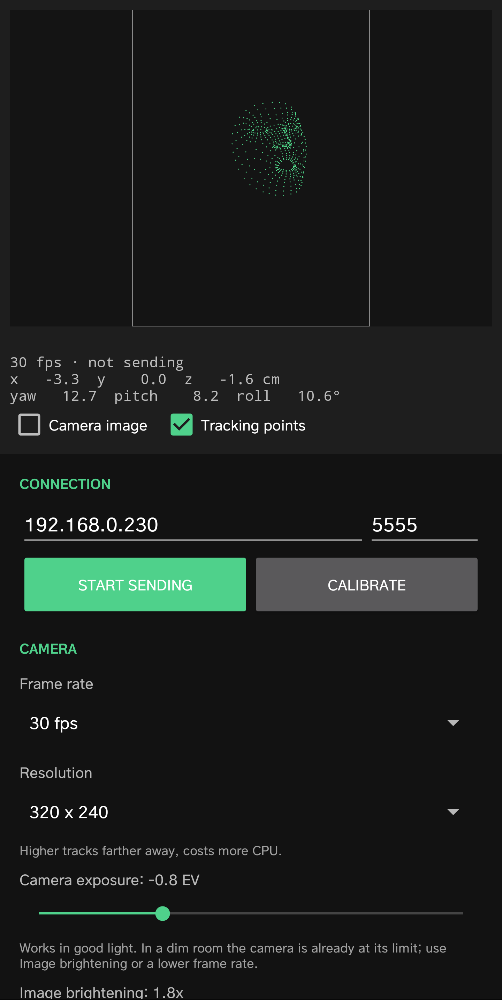

# CamHeadTracker

Head tracking with an Android phone's front camera. The app finds your face with
MediaPipe, works out your head position and rotation (6DOF), and sends it over Wi-Fi as
[OpenTrack](https://github.com/opentrack/opentrack) UDP packets.

It is meant to be used as an input for OpenTrack on your PC. OpenTrack then sends the
pose to the game.



## Requirements

- Android 7.0 or newer, 64-bit ARM (arm64-v8a), with a front camera.
- A PC running OpenTrack, on the same network as the phone.

## Installing

Download `CamHeadTracker-<version>.apk` from the
[Releases](https://github.com/Jerahya/CamHeadTracker/releases) page and open it on the
phone. Android asks you to allow installing apps from that source (your browser or file
manager) the first time. Newer releases install over older ones.

## Building

The project uses Gradle 7.4.2, Android Gradle Plugin 7.2.2 and Kotlin 1.8, and builds
with JDK 11.

**Android Studio:** open the project folder and run the `app` configuration.

**Command line (Windows):**

```bat
set JAVA_HOME=C:\Program Files\Android\Android Studio\jre
gradlew.bat assembleDebug
adb install -r app\build\outputs\apk\debug\app-debug.apk
```

On Linux or macOS, use `./gradlew assembleDebug` with `JAVA_HOME` pointing at a JDK 11.

`local.properties` must point at your Android SDK (Android Studio creates it for you):

```properties
sdk.dir=C:/Users/<you>/AppData/Local/Android/Sdk
```

The first build downloads the MediaPipe face model (`face_landmarker.task`, about
3.7 MB) into `app/src/main/assets/`. It is not part of the repository.

### Release builds

`gradlew.bat assembleRelease` signs the APK when `keystore.properties` is in the project
folder; without it the release APK is unsigned (Android does not install unsigned APKs;
use `assembleDebug` instead). The file is not part of the repository:

```properties
storeFile=keystore/camheadtracker-release.jks
storePassword=<password>
keyAlias=camheadtracker
keyPassword=<password>
```

Every release must be signed with the same key, or it will not install over the
previous one. Keep the keystore and its passwords backed up and private.

## Setup with OpenTrack (recommended)

1. In OpenTrack, set **Input** to **UDP over network**. Open its settings (hammer button)
   and set the port, for example `5555`.
2. Set **Output** to whatever your game supports, for example **freetrack 2.0 Enhanced**
   for games with TrackIR/FreeTrack support, or **UDP over network** for games that read
   OpenTrack UDP. If the output is UDP on the same PC, use a different port than the
   input (for example input `5555`, output `127.0.0.1:4242`). If both use the same
   port, OpenTrack reads its own output and the values get stuck.
3. Press **Start** in OpenTrack. Allow it through the Windows firewall on private
   networks if asked.
4. In the app, enter the PC's IP address and the input port, then tap **Start sending**.
5. Look at your monitor and tap **Calibrate**. After a 3 second countdown, that pose
   becomes the centre.

The OpenTrack octopus should now follow your head. Adjust the response in OpenTrack's
**Mapping** curves.

### Why use OpenTrack instead of sending to the game directly

- **Curves and limits.** OpenTrack maps each axis through an editable curve, so a small
  head turn can give a large view turn, with dead zones and limits where you want them.
- **Filtering.** Filters like Accela smooth the pose with little lag, and you can tune
  them while you play.
- **Hotkeys.** Re-centre, pause or toggle tracking from the PC keyboard without
  touching the phone.
- **Game support.** OpenTrack outputs to TrackIR/FreeTrack, SimConnect, mouse emulation
  and more, so one setup works for many games.
- **Network.** Many games only listen on the PC itself (`127.0.0.1`), so they never see
  packets from the phone. OpenTrack receives them on the network and passes them on
  locally.

The app can send straight to a game that accepts OpenTrack UDP over the network, but
then all tuning has to happen in the app or the game.

## App settings

**Connection**

- **PC IP address / Port:** where the packets go. Saved when you tap Start sending.
- **Calibrate:** look at your screen during the countdown. The phone can sit off to the
  side or below the monitor: the pose is measured relative to the calibrated head
  position, so it reads zero when you look at the screen. Rotating the phone starts a
  new calibration.

**Camera**

- **Frame rate:** a fixed rate keeps the delay low. *Auto* gives a brighter image, but
  in a dim room the camera slows down (to 7–8 fps on some phones), which adds a lot of
  delay. 30 fps is the default.
- **Resolution:** 320 x 240 is enough at desk distance and uses the least CPU. Higher
  resolutions track you farther from the camera.
- **Camera exposure:** asks the camera for a brighter or darker image. It works in good
  light. In a dim room the camera is usually already at its limit at 30 fps, so the
  slider has no effect there.
- **Image brightening:** brightens dark areas in the app before tracking. Works in any
  light, but also brightens the noise.

**Tracking**

- **Smoothing:** 0 sends the raw pose, which is best when OpenTrack does the filtering.
  Higher values smooth jitter while your head is still and stay quick on fast turns.
- **Axes:** per axis (x, y, z, yaw, pitch, roll), *Send* turns the axis off (sent as 0)
  and *Invert* flips its direction.

The preview shows the camera image and the tracked points. Turn either off to save a
little CPU.

## Tips

- Light your face evenly. A desk lamp beside the monitor makes tracking steadier than
  any setting, and lets you use less smoothing.
- Keep the phone fixed (a stand or a clip on the monitor) and your whole face in view.
- Keep the app open. The screen stays on while it runs.

## Packet format

Each UDP packet is 48 bytes: six little-endian doubles in this order.

| Field | Unit |
| --- | --- |
| x, y, z | centimetres |
| yaw, pitch, roll | degrees |

This is the format OpenTrack's *UDP over network* input and output use.

## License

CamHeadTracker is released under the [MIT License](LICENSE): use it, change it and share
it, personally or commercially; keep the copyright notice.

## Third-party components

- [MediaPipe Tasks Vision](https://developers.google.com/mediapipe) and the face
  landmarker model, Apache License 2.0.
- [CameraX](https://developer.android.com/training/camerax) and AndroidX AppCompat,
  Apache License 2.0.
- Smoothing uses the 1 Euro filter by Casiez, Roussel and Vogel (CHI 2012).

The APK also contains the libraries these depend on (Kotlin, Guava, Protocol Buffers and
others). [THIRD_PARTY_NOTICES.txt](THIRD_PARTY_NOTICES.txt) lists them all with their
licenses; the app shows the same text under **Open-source licenses** at the bottom of
the settings.
